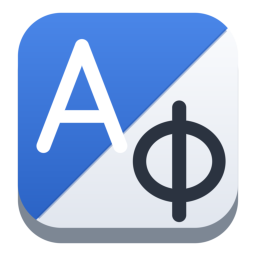
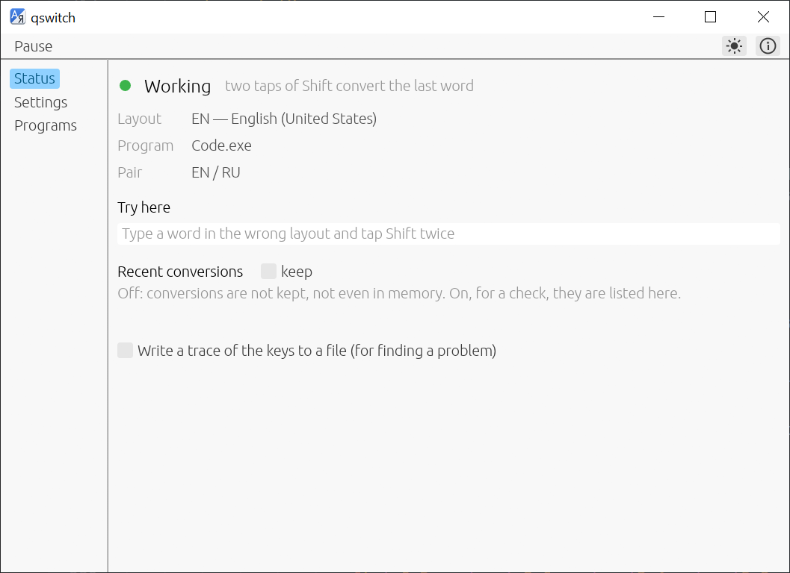

<p align="center">
  
</p>

<h1 align="center">qswitch</h1>

<p align="center">Fast keyboard layout switcher: double Shift converts what you have just typed into the other layout</p>

<p align="center">
  <a href="https://github.com/Fan4Metal/qswitch/releases/latest"></a>
  
  
  <a href="LICENSE"></a>
</p>

<p align="center"><b>English</b> | <a href="README.ru.md">Русский</a></p>

qswitch is a small keyboard layout switcher for Windows for those who write in two languages, in the spirit of Punto Switcher and Caramba Switcher. A word typed in the wrong layout (`ghbdtn` instead of `привет`, `зкштеа` instead of `printf`) is fixed with two taps of Shift: the word is replaced with the same keys read in the other layout, and the window is switched to that layout. The program lives in the notification area, shows the current layout there, and follows rules per program. Nothing typed is written to disk and nothing is sent anywhere.



*Screenshot of version 0.1.0.*

## Features

- **Two taps of Shift**: the last word is converted into the other layout and the layout is switched (see [The gesture](#the-gesture)). The same gesture repeated converts the whole line, and once more puts everything back.
- **Selected text**: with nothing typed, the gesture converts the selection instead, in any program that exposes its text to UI Automation (editors, browsers, Office, messengers).
- **Caps Lock as the layout switch**: optional; Shift+Caps Lock stays the real Caps Lock.
- **The layout in the notification area**: two letters (`EN`, `RU`) in the colour of the taskbar, grey while paused.
- **Rules per program**: do nothing in games and remote desktops, start a program in a given layout (see [Programs](#programs)).
- **Any pair of installed layouts**, not only English and Russian.
- **Light, dark or system theme.**
- **English or Russian interface**: it follows the language of Windows and can be changed in the About window (`F1`).
- **Portable**: the [portable archive](#installation) keeps its settings next to the program.
- **Privacy**: nothing typed is kept on disk; no network access beyond the optional update check (see [Update check and privacy](#update-check-and-privacy)).

## Installation

The installer and the portable archive are on the [Releases](https://github.com/Fan4Metal/qswitch/releases) page.

The installer, `qswitch_<version>_Setup.exe`, needs no administrator rights: the program is placed in `%LOCALAPPDATA%\Programs\qswitch`. It offers to start the program with Windows (the same setting is on the Gestures page). The installed program keeps its settings in `%APPDATA%\qswitch`.

The portable archive, `qswitch_<version>_portable.zip`, holds the program in a `qswitch` folder and runs without installation. It also holds an empty `qswitch.json`. While that file is next to `qswitch.exe` and the folder is writable, the settings are kept in it, so the program can be carried on a removable drive. Without the file, the program keeps them in `%APPDATA%\qswitch`, as the installed program does. The About window shows where the settings are kept.

The executables are not code-signed, so Windows SmartScreen may warn about an unknown publisher on first launch.

## The gesture

The program watches the keys typed since the caret last moved (a click, an arrow key, Enter, a change of window) and knows what each of them put on the screen in either layout of the pair. Two taps of Shift in a row, with nothing else pressed between them, do the following:

| Press | Effect |
|---|---|
| The first | The last word is erased and typed again as the same keys read in the other layout; the window is switched to that layout. |
| The second, within 1.5 s | The whole line typed since the caret last moved is converted the same way. |
| The third | Everything is put back as it was typed, and the layout too. |

With nothing typed yet, the gesture converts the selected text, if there is one: the selection is read through UI Automation, converted character by character (each goes to the other layout of the pair) and typed over the selection, and the window is switched to the layout of the result. With no selection either, the gesture only switches the layout. Programs that do not expose their text (and terminals, where typing does not replace a selection) get the layout switch alone. Instead of two taps of Shift, the Gestures page offers two taps of Ctrl or the Pause/Break key (as in Punto Switcher).

The conversion is done by erasing characters before the caret with Backspace and typing the new ones as Unicode, so it works in any program that takes keyboard input: editors, browsers, messengers, terminals. Programs that handle keys themselves (games with DirectInput, remote desktops, virtual machines) are better left alone with a rule (see [Programs](#programs)); a remote desktop, VirtualBox, VMware and Hyper-V are excluded from the start. Windows of programs running as administrator do not accept input from a program that is not, so the gesture does nothing there unless qswitch itself runs as administrator.

## Programs

The Programs page lists rules by the file name of a program's executable:

| Behaviour | Meaning |
|---|---|
| Do nothing | The gesture is off and nothing is tracked while a window of the program is in front. |
| Start in EN / Start in RU | When a window of the program comes to the front, it is put into that layout; the gesture works as usual. |

The second button under the list adds the program that was in front before the qswitch window was opened, so a rule for a game or a terminal is made by switching to it and back.

## Pause and the notification area

A click on the icon opens the window; its menu has **Show**, **Pause** (every key goes through untouched, the icon turns grey) and **Exit**. The window's close button hides it to the notification area (a setting on the Gestures page); the program is ended from the icon's menu. A second start of `qswitch.exe` only brings the window of the running copy forward; `qswitch.exe --pause`, `--resume` and `--quit` tell the running copy what to do (for scripts and game launchers), `--hidden` starts it without the window (the autostart entry).

## Keyboard shortcuts

| Key | Action |
|---|---|
| `Shift` `Shift` | Convert the last word, the line, back; with nothing typed, the selected text (the default gesture, see above) |
| `F1` | About |

## Update check and privacy

The update check is optional and off by default. With **Check for updates at start-up (once a day)** enabled in the About window, the program asks the GitHub Releases API (`api.github.com`) for the latest release at most once a day; **Check now** in the same window asks at once. The request carries nothing but the program version in its `User-Agent` header, and nothing is downloaded or installed: when a newer release exists, a button with its version appears beside the About button and opens the release page in the browser. Otherwise the program does not access the network.

The keys typed are kept in memory only as long as they can still be converted (until the caret moves), and are never written to disk; the Status page's list of recent conversions lives in memory and goes with the program. The one exception is the check box on the Status page that writes a trace of the keys to a file next to the settings, for finding out what a program does with the converted text; it is off at every start.

## Building

Requirements: Windows 10 or later, a stable Rust toolchain (MSVC target, 2024 edition) and the Visual Studio 2022 Build Tools with the C++ workload. For `build.py`, [uv](https://docs.astral.sh/uv/).

```
uv run build.py          # target\release\qswitch.exe
cargo test
```

`build.py` first closes a `qswitch.exe` running from the project's `target` folder, because it would lock the file, then runs `cargo build --release`. When the program is not running, plain `cargo build --release` works as well. The executable links the C runtime statically (`.cargo/config.toml`), so it needs nothing beyond Windows itself.

## Installer and release

The release script builds the executable, the installer and the portable archive. It needs [Inno Setup 6](https://jrsoftware.org/isinfo.php).

```
python tools/make_release.py              # tests, release build, installer, archive
python tools/make_release.py --no-tests   # the same without cargo test
python tools/make_release.py --install    # then a silent installation over the installed copy
```

The script writes the files to `dist` and takes the version from `Cargo.toml`. The installer script is `tools/setup.iss`; `qswitch.exe --export-icon <file.ico>` writes the installer icon.

Releases on GitHub are built by the **Release** workflow (`.github/workflows/release.yml`). After the version in `Cargo.toml` is updated and committed, pushing a matching tag publishes a release with the installer and the portable archive:

```
git tag v0.1.0
git push origin v0.1.0
```

The workflow stops if the tag does not match the version in `Cargo.toml`. Running the workflow manually (Actions → Release → Run workflow) builds the files and attaches them to the run, without making a release.

## Built with

qswitch is built on the following open-source projects:

- [egui / eframe](https://github.com/emilk/egui): the user interface and the window;
- [serde](https://serde.rs/) and [serde_json](https://github.com/serde-rs/json): the settings file;
- [Inno Setup](https://jrsoftware.org/isinfo.php): the installer.

## License

MIT, see [LICENSE](LICENSE).
